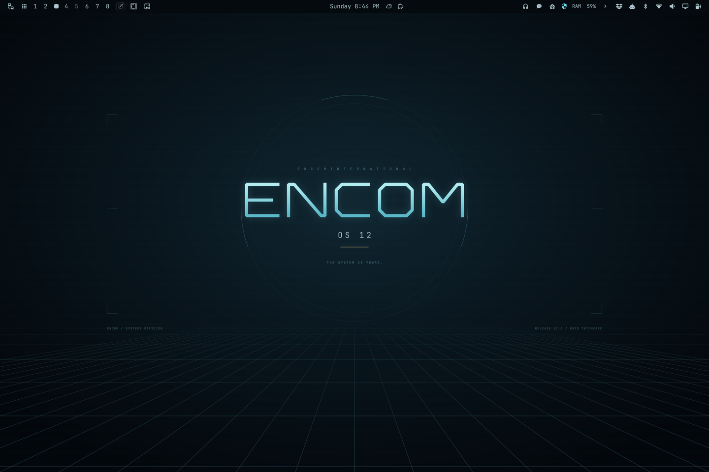

# ENCOM OS 12

A Tron-inspired theme for [Omarchy](https://omarchy.org): near-black blue surfaces, ice-white text, cyan focus borders, and restrained amber accents.



## Install

On an Omarchy desktop, run:

```bash
omarchy theme install https://github.com/dotglob/oma-encom12-theme.git
```

This downloads **and applies** the theme. The repository is public; no GitHub account or SSH key is required.

Use a recent Omarchy release with support for `colors.toml` and the Quickshell-based shell. Older Waybar-based releases are not supported by this theme's shell styling.

## Select the theme again

Choose **Oma Encom12** in Omarchy's theme picker, or run:

```bash
omarchy theme set oma-encom12
```

Omarchy derives the installed name `oma-encom12` from this repository's name. Its files are stored in:

```text
~/.config/omarchy/themes/oma-encom12/
```

To switch away, select another theme in Omarchy's theme picker.

## Update

To update only this theme and apply its latest changes:

```bash
git -C ~/.config/omarchy/themes/oma-encom12 pull --ff-only
omarchy theme set oma-encom12
```

If you have edited the installed files, preserve your changes before updating. Running the installation command again replaces the installed theme directory.

## What's included

- **Color palette:** coordinated colors for applications supported by Omarchy's theme templates, including terminals and editors.
- **Shell styling:** matching bar, menus, launcher, notifications, and lock-screen input colors.
- **Wallpaper:** an original 3840 × 2560 PNG with geometric ENCOM lettering, subtle circular detailing, and a perspective grid.
- **Editable artwork:** the wallpaper's SVG source in `artwork/encom-os-12.svg`.

| Role | Color |
| --- | --- |
| Background | `#080f14` |
| Foreground | `#c6dce2` |
| Cyan accent | `#6de0ed` |
| Amber accent | `#e8bb78` |
| Selection | `#173d48` |

The theme does not change your fonts, keybindings, monitor configuration, or idle timings. **The animated ENCOM screensaver is not included in this repository.**

## Customize

Edit `colors.toml` to adjust the shared palette and `shell.toml` to adjust shell surfaces. Then reapply the theme with `omarchy theme set oma-encom12`.

The wallpaper uses JetBrains Mono for its small labels. The included PNG is already rendered; the font is only needed to reproduce those labels when editing or rendering the SVG.

---

Tron is a trademark of Disney. This is an unofficial fan-made theme, not affiliated with or endorsed by Disney.
